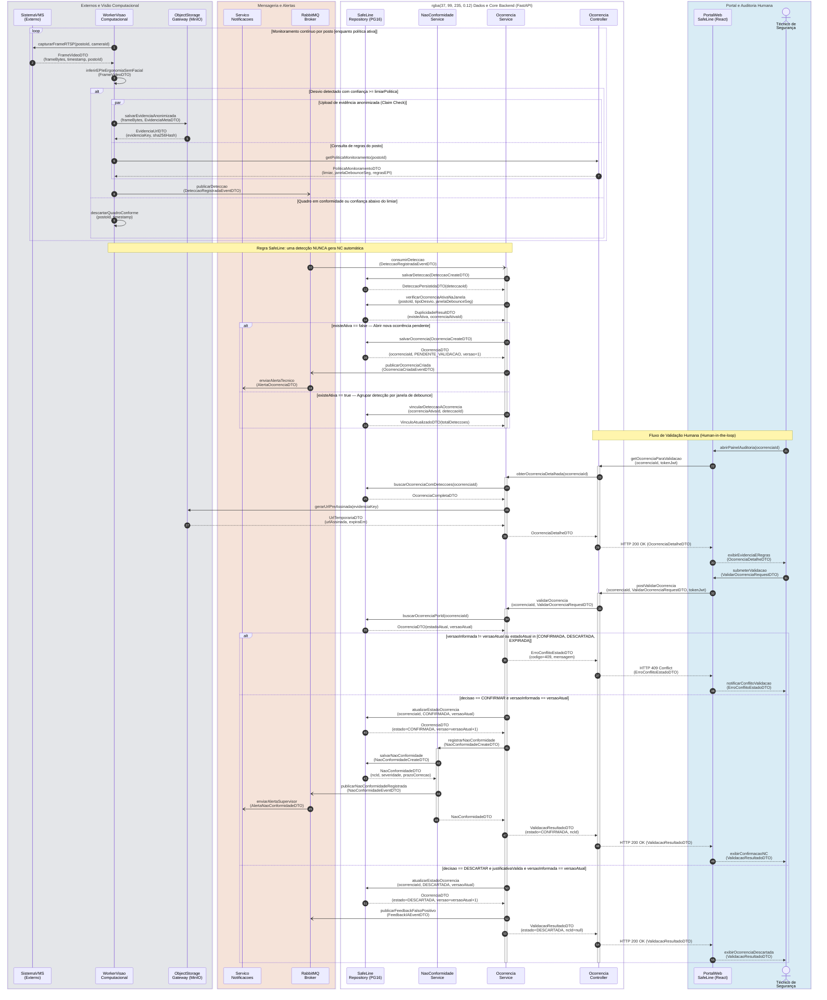
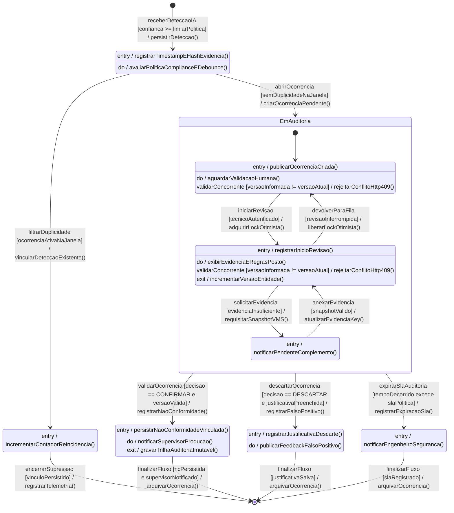
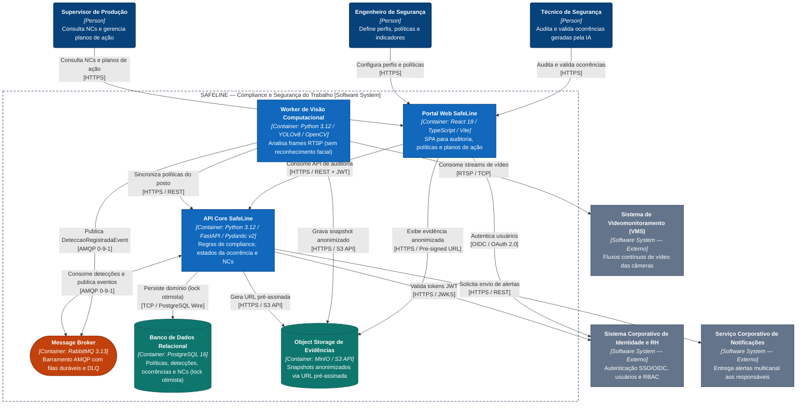
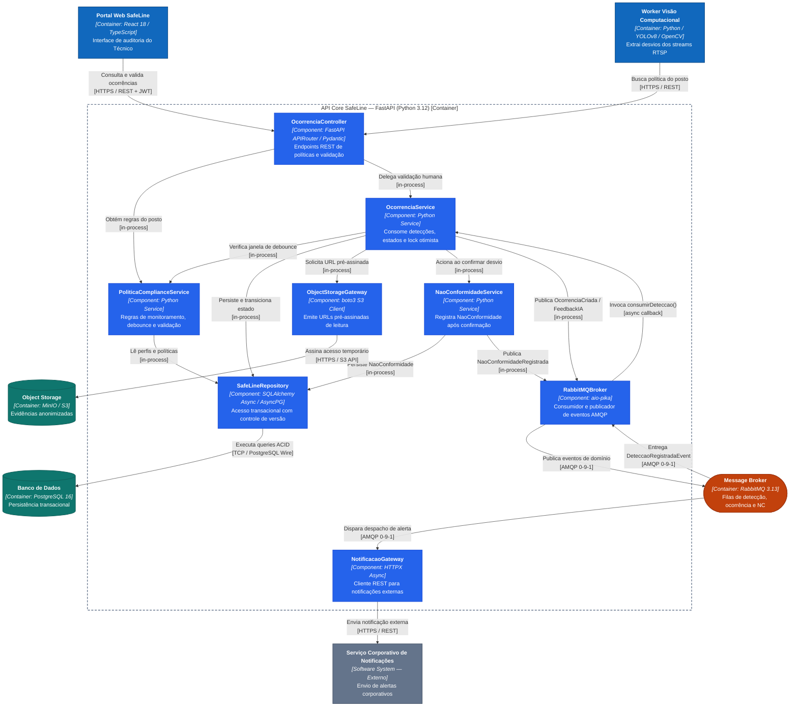

# Dossiê de Arquitetura Viva — SAFELINE (APS 3)

> **Unidade Curricular:** Modelagem de Software (4º Período — Engenharia de Software / UniSenai)  
> **Docente:** Prof. Sidney L. da Silva  
> **Estudante:** Felipe Heiras  
> **Modalidade:** Avaliação Prática Supervisionada (APS 3) — Individual  
> **Paradigma:** *Diagrams-as-Code (DaC)* & *Models-as-Code (MaC)*  

---

## 1. Contextualização e Funcionalidade Crítica Selecionada

O **SAFELINE** é um Sistema de Compliance, Segurança do Trabalho e Ergonomia voltado ao monitoramento de uso de Equipamentos de Proteção Individual (EPIs) e condições ergonômicas observáveis em linhas de produção industriais por meio de visão computacional.

### Funcionalidade Crítica Modelada
**Auditoria por Visão Computacional (EPI/Ergonomia), Geração de Ocorrência de Segurança e Validação Humana para Registro de Não Conformidade (NC).**

### Regras de Negócio e Decisões de Domínio do Projeto SAFELINE
Os modelos deste dossiê incorporam integralmente as decisões arquiteturais e de negócio definidas pela equipe:
1. **Uma detecção não gera uma Não Conformidade (NC) automaticamente:** toda detecção válida originada pela visão computacional passa por filtragem de política/debounce e origina uma `OcorrenciaDeSeguranca` no estado `PENDENTE_VALIDACAO`.
2. **A IA não substitui o profissional de Segurança (*Human-in-the-loop*):** somente o **Técnico de Segurança** possui autoridade para validar uma ocorrência, decidindo entre **Confirmar Desvio** (gerando a `NaoConformidade` formal) ou **Descartar Ocorrência** (registrando falso positivo/justificativa).
3. **Privacidade por Design (sem reconhecimento facial inicial):** a análise computacional identifica ausência de EPIs e posturas críticas associadas ao **Posto de Trabalho / Atividade**, anonimizando as evidências armazenadas sem biometria facial do colaborador.
4. **Escopo ergonômico observável:** a câmera analisa apenas indicadores ergonômicos observáveis configurados na `PoliticaDeMonitoramento`, sem substituir a avaliação ergonômica clínica completa.

---

## 2. Estrutura do Repositório

```text
aps3-felipe-heiras/
├── docs/
│   ├── architecture/
│   │   ├── workspace.dsl      # Modelos C4 (Níveis 1, 2 e 3) em Structurizr DSL
│   │   └── adr-0001.md        # Registro de Decisão Arquitetural (Formato Nygard)
│   └── diagrams/
│       ├── sequencia.mmd      # Artefato 1 — Diagrama de Sequência (Mermaid)
│       ├── atividades.mmd     # Artefato 2 — Diagrama de Atividades com Raias (Mermaid)
│       └── estados.mmd        # Artefato 3 — Máquina de Estados da OcorrenciaDeSeguranca (Mermaid)
└── README.md                  # Documento Principal com explicações e diagramas renderizados
```

---

## 3. Artefato 1 — Diagrama de Sequência (`sequencia.mmd`)

**Arquivo fonte:** [`docs/diagrams/sequencia.mmd`](docs/diagrams/sequencia.mmd)

Mapeia a troca cronológica de mensagens em tempo de execução entre o sistema externo de câmeras (`VMS`), o pipeline assíncrono de visão computacional, o barramento de eventos (`RabbitMQ`), o núcleo transacional (`FastAPI` + `PostgreSQL 16`), o repositório de evidências (`MinIO/S3`), o portal web (`React`) e o **Técnico de Segurança**.

- **Chamadas síncronas bloqueantes (`->>` / `-->>`):** captura de frame RTSP, upload de evidência no MinIO, persistência ACID no PostgreSQL, consultas REST e validação humana com verificação de lock otimista (`HTTP 200` ou `HTTP 409 Conflict`).
- **Chamadas assíncronas / mensageria (`-)`):** publicação e consumo de eventos de domínio via `RabbitMQBroker` (`DeteccaoRegistradaEventDTO`, `OcorrenciaCriadaEventDTO`, `NaoConformidadeEventDTO`, `FeedbackIAEventDTO`) e disparo de alertas externos.
- **Fragmentos combinados:** `loop` para monitoramento contínuo por posto, `par / and` para upload de evidência em paralelo à leitura de política, e `alt / else` para tratamento de limiar, debounce e exceção de concorrência (`HTTP 409`).



### Contrato de Operações Públicas e DTOs (Consistência Interface ↔ Mensagem)

| Participante (Classe / Interface / Componente) | Operações Públicas Declaradas | DTOs de Entrada / Retorno |
|---|---|---|
| `SistemaVMS` | `capturarFrameRTSP(postoId, cameraId)` | `FrameVideoDTO` |
| `WorkerVisaoComputacional` | `inferirEPIeErgonomiaSemFacial(FrameVideoDTO)`, `descartarQuadroConforme(postoId, timestamp)` | `FrameVideoDTO` |
| `ObjectStorageGateway` | `salvarEvidenciaAnonimizada(frameBytes, EvidenciaMetaDTO)`, `gerarUrlPreAssinada(evidenciaKey)` | `EvidenciaMetaDTO`, `EvidenciaUrlDTO`, `UrlTemporariaDTO` |
| `OcorrenciaController` | `getPoliticaMonitoramento(postoId)`, `getOcorrenciaParaValidacao(ocorrenciaId, tokenJwt)`, `postValidarOcorrencia(ocorrenciaId, ValidarOcorrenciaRequestDTO, tokenJwt)` | `PoliticaMonitoramentoDTO`, `OcorrenciaDetalheDTO`, `ValidarOcorrenciaRequestDTO`, `ValidacaoResultadoDTO`, `ErroConflitoEstadoDTO` |
| `RabbitMQBroker` | `publicarDeteccao(...)`, `publicarOcorrenciaCriada(...)`, `publicarNaoConformidadeRegistrada(...)`, `publicarFeedbackFalsoPositivo(...)` | `DeteccaoRegistradaEventDTO`, `OcorrenciaCriadaEventDTO`, `NaoConformidadeEventDTO`, `FeedbackIAEventDTO` |
| `OcorrenciaService` | `consumirDeteccao(DeteccaoRegistradaEventDTO)`, `obterOcorrenciaDetalhada(ocorrenciaId)`, `validarOcorrencia(ocorrenciaId, ValidarOcorrenciaRequestDTO)` | `OcorrenciaDetalheDTO`, `ValidacaoResultadoDTO`, `ErroConflitoEstadoDTO` |
| `SafeLineRepository` | `salvarDeteccao(...)`, `verificarOcorrenciaAtivaNaJanela(...)`, `salvarOcorrencia(...)`, `vincularDeteccaoAOcorrencia(...)`, `buscarOcorrenciaComDeteccoes(...)`, `buscarOcorrenciaPorId(...)`, `atualizarEstadoOcorrencia(...)`, `salvarNaoConformidade(...)` | `DeteccaoPersistidaDTO`, `DuplicidadeResultDTO`, `OcorrenciaDTO`, `OcorrenciaCompletaDTO`, `NaoConformidadeDTO` |
| `NaoConformidadeService` | `registrarNaoConformidade(NaoConformidadeCreateDTO)` | `NaoConformidadeCreateDTO`, `NaoConformidadeDTO` |
| `ServicoNotificacoes` | `enviarAlertaTecnico(AlertaOcorrenciaDTO)`, `enviarAlertaSupervisor(AlertaNaoConformidadeDTO)` | `AlertaOcorrenciaDTO`, `AlertaNaoConformidadeDTO` |
| `PortalWebSafeLine` | `abrirPainelAuditoria(ocorrenciaId)`, `submeterValidacao(ValidarOcorrenciaRequestDTO)`, `exibirEvidenciaERegras(...)`, `notificarConflitoValidacao(...)`, `exibirConfirmacaoNC(...)`, `exibirOcorrenciaDescartada(...)` | `OcorrenciaDetalheDTO`, `ValidarOcorrenciaRequestDTO`, `ValidacaoResultadoDTO`, `ErroConflitoEstadoDTO` |

---

## 4. Artefato 2 — Diagrama de Atividades com Raias (`atividades.mmd`)

**Arquivo fonte:** [`docs/diagrams/atividades.mmd`](docs/diagrams/atividades.mmd)

Representa o fluxo de trabalho e a concorrência distribuída em **4 Raias de Partição (Swimlanes)**:
1. **Raia 1 — VMS e Worker de Visão Computacional**
2. **Raia 2 — Core Backend SafeLine (FastAPI / RabbitMQ / PostgreSQL 16)**
3. **Raia 3 — Técnico de Segurança (Portal Web React)**
4. **Raia 4 — Serviço Corporativo de Notificações e Supervisor**

O diagrama aplica **condições de guarda mutuamente exclusivas** em todos os nós de decisão e emprega **Barras de Fork (Divisão) e Join (Sincronização)** para modelar paralelismo real em três momentos críticos: upload de evidência no MinIO em paralelo ao enriquecimento de metadados no Worker; disponibilização no painel em paralelo ao envio de alerta ao Técnico; e notificação ao Supervisor em paralelo à gravação da trilha de auditoria pós-NC.

```mermaid
flowchart TD
    classDef startEnd fill:#111827,stroke:#111827,color:#ffffff,font-weight:bold
    classDef forkJoin fill:#1e293b,stroke:#0f172a,color:#ffffff,stroke-width:3px,font-weight:bold
    classDef decision fill:#fef3c7,stroke:#d97706,color:#111827,stroke-width:2px
    classDef action fill:#ffffff,stroke:#334155,color:#0f172a,stroke-width:1.5px
    classDef errorAction fill:#fee2e2,stroke:#dc2626,color:#7f1d1d,stroke-width:1.5px

    subgraph RaiaVMS["Raia 1 — VMS e Worker de Visão Computacional"]
        Start(["Início"]):::startEnd
        CapFrame["Capturar quadro RTSP do VMS<br/>e executar inferência EPI/Ergonomia<br/>(sem reconhecimento facial)"]:::action
        DecLimiar{"Desvio detectado e<br/>confiança >= limiar?"}:::decision
        DescartarQuadro["Descartar quadro em conformidade<br/>e manter ciclo de captura"]:::action
        ForkWorker["━━━ FORK: Processamento Paralelo no Worker ━━━"]:::forkJoin
        UploadMinIO["Anonimizar e gravar snapshot<br/>no Object Storage (MinIO/S3)"]:::action
        EnriquecerMeta["Consultar política do posto e<br/>montar DeteccaoRegistradaEventDTO"]:::action
        JoinWorker["━━━ JOIN: Sincronização Evidência + Metadados ━━━"]:::forkJoin
        PublicarDeteccao["Publicar DeteccaoRegistradaEvent<br/>no RabbitMQ (AMQP)"]:::action
    end

    subgraph RaiaBackend["Raia 2 — Core Backend SafeLine (FastAPI / RabbitMQ / PostgreSQL 16)"]
        ConsumirDeteccao["Consumir DeteccaoRegistradaEvent<br/>e persistir Deteccao no PostgreSQL"]:::action
        DecDebounce{"Existe ocorrência ativa<br/>similar na janela<br/>de debounce?"}:::decision
        VincularExistente["Vincular detecção à ocorrência ativa<br/>(suprimir duplicidade)"]:::action
        CriarOcorrencia["Criar OcorrenciaDeSeguranca<br/>(estado = PENDENTE_VALIDACAO, versao = 1)"]:::action
        ForkAbertura["━━━ FORK: Disponibilização e Alerta Assíncrono ━━━"]:::forkJoin
        DisponibilizarPainel["Disponibilizar ocorrência e URL<br/>pré-assinada no painel de auditoria"]:::action
        PublicarOcorrencia["Publicar OcorrenciaCriadaEvent<br/>no RabbitMQ"]:::action
        JoinAbertura["━━━ JOIN: Ocorrência Pronta para Auditoria Humana ━━━"]:::forkJoin
        ValidarLock["Verificar versão otimista e<br/>estado atual da ocorrência"]:::action
        DecConcorrencia{"Versão informada == versão atual<br/>e estado em auditoria?"}:::decision
        Rejeitar409["Rejeitar transição com HTTP 409 Conflict<br/>(proteção contra estado corrompido)"]:::errorAction
        RegistrarNC["Atualizar ocorrência para CONFIRMADA<br/>e registrar NaoConformidade no PostgreSQL"]:::action
        RegistrarDescarte["Atualizar ocorrência para DESCARTADA<br/>e publicar FeedbackIAEvent (falso positivo)"]:::action
    end

    subgraph RaiaTecnico["Raia 3 — Técnico de Segurança (Portal Web React)"]
        ReceberAlertaTec["Acessar ocorrência pendente<br/>e revisar evidência + regras do posto"]:::action
        DecHumana{"Decisão humana<br/>do Técnico de<br/>Segurança?"}:::decision
        ConfirmarDesvio["Submeter validação:<br/>decisao = CONFIRMAR"]:::action
        DescartarDesvio["Submeter validação:<br/>decisao = DESCARTAR + justificativa"]:::action
        VisualizarConflito["Exibir aviso de ocorrência<br/>já auditada por outro técnico"]:::errorAction
    end

    subgraph RaiaNotif["Raia 4 — Serviço Corporativo de Notificações e Supervisor"]
        NotificarTec["Entregar alerta de nova ocorrência<br/>ao Técnico de Segurança"]:::action
        ForkNC["━━━ FORK: Pós-Confirmação de Não Conformidade ━━━"]:::forkJoin
        NotificarSup["Publicar NaoConformidadeEvent e<br/>alertar Supervisor de Produção"]:::action
        GravarAudit["Gravar trilha imutável de auditoria<br/>e atualizar indicadores de compliance"]:::action
        JoinNC["━━━ JOIN: Sincronização Pós-NC ━━━"]:::forkJoin
        Fim(["Fim"]):::startEnd
    end

    Start --> CapFrame
    CapFrame --> DecLimiar
    DecLimiar -->|"[confianca abaixo do limiar ou conforme]"| DescartarQuadro
    DescartarQuadro --> CapFrame
    DecLimiar -->|"[desvio == true e confianca >= limiarPolitica]"| ForkWorker

    ForkWorker --> UploadMinIO
    ForkWorker --> EnriquecerMeta
    UploadMinIO --> JoinWorker
    EnriquecerMeta --> JoinWorker
    JoinWorker --> PublicarDeteccao

    PublicarDeteccao --> ConsumirDeteccao
    ConsumirDeteccao --> DecDebounce
    DecDebounce -->|"[existeOcorrenciaAtiva == true]"| VincularExistente
    VincularExistente --> Fim
    DecDebounce -->|"[existeOcorrenciaAtiva == false]"| CriarOcorrencia

    CriarOcorrencia --> ForkAbertura
    ForkAbertura --> DisponibilizarPainel
    ForkAbertura --> PublicarOcorrencia
    PublicarOcorrencia --> NotificarTec
    DisponibilizarPainel --> JoinAbertura
    NotificarTec --> JoinAbertura

    JoinAbertura --> ReceberAlertaTec
    ReceberAlertaTec --> DecHumana
    DecHumana -->|"[decisao == CONFIRMAR]"| ConfirmarDesvio
    DecHumana -->|"[decisao == DESCARTAR e justificativaValida]"| DescartarDesvio

    ConfirmarDesvio --> ValidarLock
    DescartarDesvio --> ValidarLock
    ValidarLock --> DecConcorrencia

    DecConcorrencia -->|"[versaoValida == false ou estadoTerminal]"| Rejeitar409
    Rejeitar409 --> VisualizarConflito
    VisualizarConflito --> Fim

    DecConcorrencia -->|"[versaoValida == true e decisao == DESCARTAR]"| RegistrarDescarte
    RegistrarDescarte --> Fim

    DecConcorrencia -->|"[versaoValida == true e decisao == CONFIRMAR]"| RegistrarNC
    RegistrarNC --> ForkNC
    ForkNC --> NotificarSup
    ForkNC --> GravarAudit
    NotificarSup --> JoinNC
    GravarAudit --> JoinNC
    JoinNC --> Fim
```



---

## 5. Artefato 3 — Diagrama de Transição de Estados (`estados.mmd`)

**Arquivo fonte:** [`docs/diagrams/estados.mmd`](docs/diagrams/estados.mmd)

Modela o ciclo de vida rigoroso da entidade de domínio central **`OcorrenciaDeSeguranca`**, protegendo o sistema contra transições inválidas, geração automática indevida de NCs e condições de corrida entre múltiplos técnicos.

- **Estado Inicial (`[*]`) e Estados Terminais (`[*]`):** ciclo completo desde a recepção da detecção até o encerramento imutável.
- **Estado Composto com Subestados (`EmAuditoria`):** engloba `PendenteValidacao`, `EmAnaliseTecnica` e `AguardandoComplemento`.
- **Compartimentos Internos (`entry /`, `do /`, `exit /`):** explícitos nos estados `Detectada`, `Suprimida`, `PendenteValidacao`, `EmAnaliseTecnica`, `AguardandoComplemento`, `Confirmada`, `Descartada` e `Expirada`.
- **Sintaxe Formal de Transição:** `Gatilho [CondiçãoDeGuarda] / AçãoDeEfeito()`, incluindo transição interna defensiva em `EmAuditoria` (`PendenteValidacao` / `EmAnaliseTecnica`: `rejeitarConflitoHttp409()`) quando a versão otimista diverge.



---

## 6. Artefato 4 — Visão Arquitetural Macro C4 (`workspace.dsl` + Mermaid C4)

**Arquivo fonte Structurizr DSL:** [`docs/architecture/workspace.dsl`](docs/architecture/workspace.dsl) *(contém C4 Nível 1 — Contexto, C4 Nível 2 — Contêineres e C4 Nível 3 — Componentes)*

Abaixo estão espelhadas as visões **C4 Nível 2 (Contêineres)** e **C4 Nível 3 (Componentes da API Core)** em **Mermaid (`flowchart` com notação e paleta C4)** para renderização nativa no GitHub sem sobreposição de setas ou rótulos, mantendo total equivalência com o modelo em [`workspace.dsl`](docs/architecture/workspace.dsl).

### 6.1. C4 Nível 2 — Diagrama de Contêineres



### 6.2. C4 Nível 3 — Diagrama de Componentes da API Core SafeLine



> **Visualização do Structurizr DSL:** para renderizar localmente o arquivo [`docs/architecture/workspace.dsl`](docs/architecture/workspace.dsl), execute o **Structurizr Lite** via Docker apontando para `docs/architecture/` ou importe o arquivo no [Structurizr Playground](https://structurizr.com/dsl).

---

## 7. Artefato 5 — Registro de Decisão Arquitetural (`ADR 0001`)

**Arquivo fonte:** [`docs/architecture/adr-0001.md`](docs/architecture/adr-0001.md)

### ADR 0001 — Desacoplamento do Pipeline de Visão Computacional e Validação via Mensageria Assíncrona (RabbitMQ)

- **Status:** Aprovado  
- **Contexto:** O monitoramento contínuo de câmeras RTSP do VMS gera picos de inferência de EPIs e postura ergonômica observável. Se o `Worker de Visão Computacional` chamasse a `API Core` de forma síncrona (HTTP/REST) com payloads de imagem para gravar ocorrências e disparar alertas, lentidões no banco relacional ou no `Serviço Corporativo de Notificações` causariam bloqueio na inferência, descarte de frames, acoplamento temporal e risco de duplicidade de Não Conformidades.
- **Decisão:** Adotar **RabbitMQ 3.13 (AMQP 0-9-1)** como barramento assíncrono de eventos entre o Worker de IA, a `API Core (FastAPI)` e o envio de alertas externos, combinado ao padrão **Claim Check** (imagens anonimizadas gravadas em paralelo no **MinIO/S3** trafegando apenas `evidenciaKey` na fila), **Dead Letter Queues (DLQ)** para resiliência e **controle de concorrência otimista (`version`) no PostgreSQL 16** para impedir estados corrompidos durante a validação humana. Chamadas HTTP síncronas diretas e Apache Kafka foram avaliados e descartados frente ao equilíbrio entre confiabilidade, roteamento e simplicidade operacional.
- **Consequências:**
  - *Vantagens:* absorção de picos (*backpressure*), escalabilidade independente entre Workers de GPU/CPU e API transacional, preservação estrita da regra de negócio (*detecção não gera NC automática*) e tolerância a falhas via retries/DLQ.
  - *Riscos / Débitos aceitos:* consistência eventual de milissegundos entre detecção e exibição no painel, necessidade de monitorar profundidade das filas/DLQ e exigência de idempotência por `deteccaoId` nos consumidores.

---

## 8. Matriz de Consistência Lógica entre Modelos

| Etapa do Fluxo | Sequência (`sequencia.mmd`) | Atividades (`atividades.mmd`) | Estados (`estados.mmd`) | C4 (`workspace.dsl`) |
|---|---|---|---|---|
| **1. Captura e Inferência** | `Worker->>VMS: capturarFrameRTSP` + `inferirEPIeErgonomiaSemFacial` | Raia 1: Capturar RTSP -> Decisão `[desvio == true e confianca >= limiarPolitica]` | `[*] --> Detectada : receberDeteccaoIA [...]` | `Worker de Visão Computacional` -> `VMS` (`RTSP / TCP`) |
| **2. Evidência e Contexto em Paralelo** | `par` `Storage.salvarEvidenciaAnonimizada` `and` `Ctrl.getPoliticaMonitoramento` | **ForkWorker** -> (Upload MinIO \|\| Enriquecer metadados) -> **JoinWorker** | `Detectada`: `entry / registrarTimestampEHashEvidencia()` | `Worker` -> `MinIO/S3` (`HTTPS`) & `API Core` (`HTTPS`) |
| **3. Debounce e Abertura de Ocorrência** | `Worker-)Broker` -> `OcorrenciaSvc.consumirDeteccao` -> `alt` cria `PENDENTE_VALIDACAO` ou agrupa | Raia 2: Decisão `[existeOcorrenciaAtiva]` -> suprime ou cria `OcorrenciaDeSeguranca` + **ForkAbertura** | `Detectada --> Suprimida` ou `Detectada --> EmAuditoria` (`[*] --> PendenteValidacao`) | `RabbitMQBroker` -> `OcorrenciaService` -> `SafeLineRepository` (`PostgreSQL 16`) |
| **4. Auditoria Humana e Lock Otimista** | `Tecnico` -> `Portal` -> `Ctrl.postValidarOcorrencia` -> `alt` `409 Conflict` / `CONFIRMAR` / `DESCARTAR` | Raia 3 (`DecHumana`) -> Raia 2 (`ValidarLock` / `DecConcorrencia`) | `EmAnaliseTecnica` (`exit / incrementarVersaoEntidade()`); transição interna `409` em `EmAuditoria` | `Portal Web (React)` -> `OcorrenciaController` -> `OcorrenciaService` |
| **5. Emissão de NC e Alerta** | `NCSvc.registrarNaoConformidade` -> `Repo` -> `Broker-)Notif.enviarAlertaSupervisor` | Raia 2 (`RegistrarNC`) -> **ForkNC** -> (Raia 4 `NotificarSup` \|\| `GravarAudit`) -> **JoinNC** -> `Fim` | `EmAuditoria --> Confirmada` (`entry / persistirNaoConformidadeVinculada()`, `do / notificarSupervisorProducao()`) -> `[*]` | `NaoConformidadeService` -> `RabbitMQBroker` -> `NotificacaoGateway` -> `Notificações` |

---

## 9. Declaração de Autoria Individual

Declaro que este Dossiê de Arquitetura Viva (modelos UML em Mermaid, visão arquitetural C4 em Structurizr DSL / Mermaid e registro ADR 0001) foi elaborado individualmente por **Felipe Heiras** para a **Avaliação Prática Supervisionada (APS 3)** da disciplina de **Modelagem de Software (UniSenai)**, refletindo a funcionalidade crítica selecionada para o projeto **SAFELINE**.

